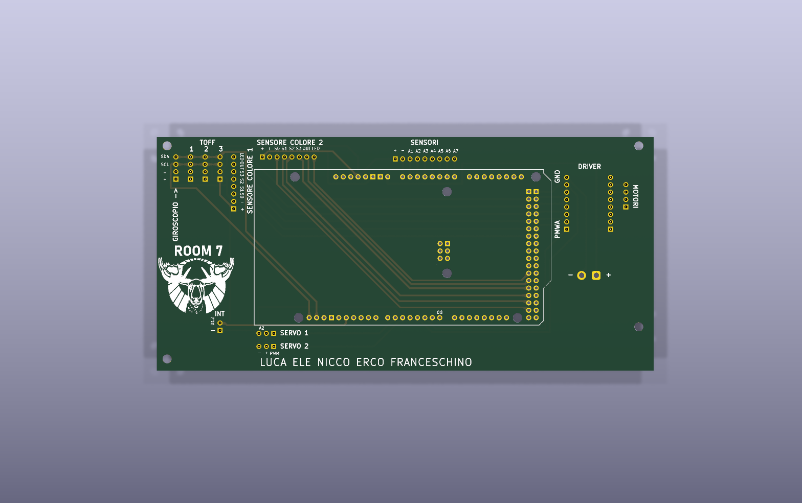
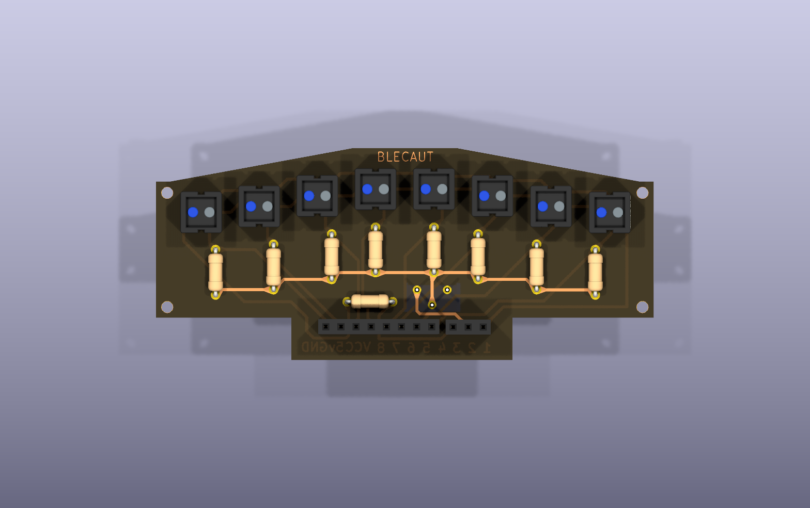

# Electronics & Robotics Portfolio

Electronic Engineering student at **Politecnico di Torino**, currently at **Tongji University** through the **POLITONG** program.

I was part of the **embedded branch of [Team ISAAC](https://github.com/Team-Isaac-Polito)** (2025–2026), where I designed the team's [LoRa remote kill switch](pcb-lora-kill-switch/). The team took part in the **RoboCup 2026 Rescue Robot League** in Korea, finishing **21st** as the **only Italian team**.

This repository collects my personal electronics and robotics projects: PCB design, embedded firmware and computer vision.

## Projects

| Project | What it is | Technologies | Status |
|---|---|---|---|
| [RoboCup Junior Rescue Line robot](robocup-junior-rescue-line/) | Line-following robot with computer vision for green intersection markers, plus a custom line-sensor PCB and 3D-printed chassis (team project) | Arduino, Raspberry Pi, Python, OpenCV, TensorFlow Lite, KiCad | Competed for three seasons, reached the national finals in the last one |
| [Arduino Mega shield](pcb-arduino-mega-shield/) | Main board of the RoboCup Junior robot: plugs onto an Arduino Mega and wires up sensors, motor driver and servos | KiCad, Gerber | Manufactured and used in competition |
| [LoRa remote kill switch](pcb-lora-kill-switch/) | Transmitter and receiver boards for a wireless emergency stop (Team ISAAC) | Altium Designer, RP2040, LoRa | Manufactured and tested |
| [Vision-controlled robotic hand](vision-robotic-hand/) | A webcam tracks my hand and a 5-servo robotic hand copies the finger positions | Python, OpenCV, MediaPipe, Arduino | Prototype |

The RoboCup Junior robot and its Mega shield were built together with Niccolò, Eleonora, Francesco and Ercolini.

<p align="center">
  
  
</p>

## Repository layout

```
pcb-arduino-mega-shield/      KiCad project, schematic and PCB PDFs, Gerber files
pcb-lora-kill-switch/         Schematic + PCB PDFs, layout images, interactive 3D PDFs
vision-robotic-hand/          Python hand tracking + Arduino servo firmware
robocup-junior-rescue-line/   Arduino firmware, Raspberry Pi vision, line-sensor PCB, STL files
media/                        Renders and images used in the READMEs
```

## Tools

KiCad · Altium Designer · Arduino · Raspberry Pi · RP2040 · Python · OpenCV · MediaPipe · TensorFlow Lite · 3D printing
