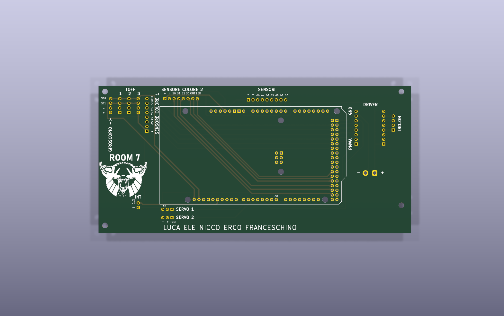

# Arduino Mega Shield

Main interface board for my RoboCup Junior Rescue Line robot ([robocup-junior-rescue-line](../robocup-junior-rescue-line/)). It plugs onto an **Arduino Mega**. It replaces loose jumper wires with labelled connectors for every sensor and actuator on the robot.

Part of the RoboCup Junior project built together with **Niccolò, Eleonora, Francesco and Ercolini** (their names are on the silkscreen, next to the team logo).

## Connectors on the board

- 3 × I²C headers for **VL53L0X time-of-flight** distance sensors (SDA/SCL)
- **Gyroscope** header with interrupt pin
- 2 × **TCS3200 colour sensor** headers (S0–S3, OUT, LED)
- Line-sensor input header on analog pins A1–A7
- **TB6612FNG motor driver** header (PWM A/B) and motor outputs
- 2 × **servo** headers
- 12 V power input

## Files

| Path | Content |
|---|---|
| `kicad/` | KiCad project (`.kicad_pro`, `.kicad_sch`, `.kicad_pcb`) |
| `images/mega_shield_schematic.pdf` | Schematic, exported with `kicad-cli` |
| `images/mega_shield_pcb.pdf` | PCB prints, one page per layer (front copper, back copper, silkscreen, outline) |
| `images/mega_shield_layout.svg` | Copper and silkscreen layout |
| `fabrication/mega_shield_gerber.zip` | Gerber and drill files for manufacturing |

## Tools

KiCad (the shield outline uses the Arduino Due/Mega form factor symbol)

## Status

Manufactured and used in competition.
