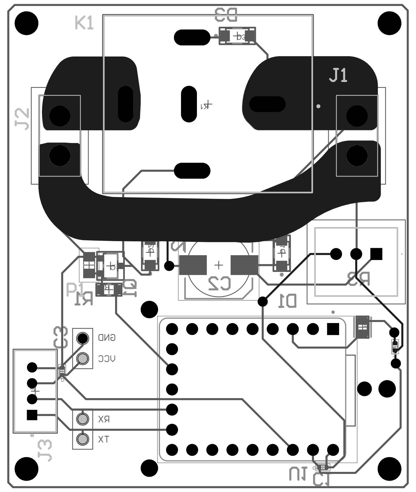
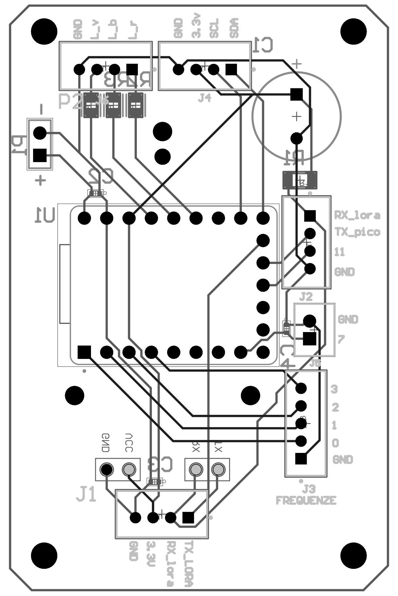

# LoRa Remote Kill Switch

Wireless emergency stop for a rescue robot, made for **Team ISAAC** (Politecnico di Torino). A **transmitter** board with an emergency mushroom button sends the command over **LoRa**. The **receiver** board switches a 40 A automotive relay on the robot's power line.

I designed the two PCBs in **Altium Designer** during my time in the team's embedded branch (2025–2026). The firmware is developed by the team: see [Team ISAAC on GitHub](https://github.com/Team-Isaac-Polito).

Only documentation is published here (schematics, layout prints, images and 3D views). The design files and fabrication outputs belong to the team.

## Documents

| Board | Schematic + PCB print | Interactive 3D |
|---|---|---|
| Receiver | [kill_switch_receiver.pdf](docs/kill_switch_receiver.pdf) | [kill_switch_receiver_3d.pdf](3d/kill_switch_receiver_3d.pdf) |
| Transmitter | [kill_switch_transmitter.pdf](docs/kill_switch_transmitter.pdf) | [kill_switch_transmitter_3d.pdf](3d/kill_switch_transmitter_3d.pdf) |

The 3D PDFs must be downloaded and opened in Adobe Acrobat Reader to rotate the board. The GitHub preview cannot show the 3D content.

## Receiver

- **RP2040-Zero** microcontroller with a status LED
- Grove connector for the **Seeed Grove LoRa-E5** module (UART)
- **Panasonic CB1-P-12V** automotive relay (SPDT, 40 A) driven by an **AO3400A** MOSFET, with flyback diode and wide copper pours for the high-current path
- **OKI-78SR-5** 5 V switching regulator from the 12 V input
- **XT30** power input/output connectors and Schottky protection diodes

## Transmitter

- **RP2040-Zero** microcontroller
- Connector for the **emergency mushroom button** (NO/NC contacts)
- Grove connector for the **LoRa** module (UART)
- 4-position **frequency selector** and frequency-confirm button
- I²C **display** connector and **RGB status LED** connector

## Tools

Altium Designer

## Status

Manufactured and tested.
