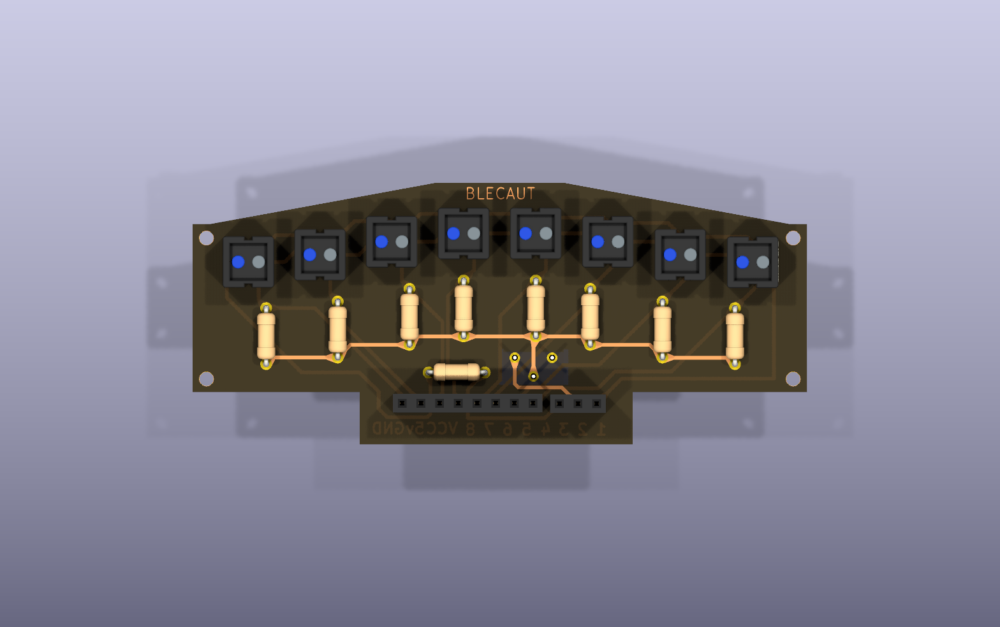

# RoboCup Junior Rescue Line Robot – "Blecaut"

Autonomous robot for the **RoboCup Junior Rescue Line** challenge. Our team **competed for three seasons** and **reached the national finals** in the last one.

The robot follows a black line, handles green intersection markers and avoids obstacles. An **Arduino** runs the low-level control and a **Raspberry Pi** with a camera runs the computer vision. The two talk over serial.

## Team

Built together with **Niccolò, Eleonora, Francesco and Ercolini**. The robot, its boards and its code are a shared team effort.

## Contents

### `arduino/`: low-level control
| Sketch | Role |
|---|---|
| `seguiline_finale_sensori_di_colore_1.0` | Final line-following firmware (Arduino Mega): reflective line sensors, 2 × TCS3200 colour sensors for green markers, TB6612FNG motor driver, serial commands from the Raspberry Pi |
| `ultimo_nano_sensori_seguilinea_motori_12` | Line-following firmware for the Arduino Nano version of the robot |
| `2_seguilinea_completo_toff_seriale_1.0` | Line following with 2 × VL53L0X time-of-flight sensors for obstacle detection |
| `2_settaggio_sensori_di_colore_1.0` | Calibration tool for the colour sensors |

### `raspberry-pi/`: computer vision
| File | Role |
|---|---|
| `green_marker_detection.py` | Finds green markers and the black line using combined HSV + LAB masks. Uses contour geometry to decide the direction: **A**vanti (straight), **S**inistra (left), **D**estra (right), **I**nversione (U-turn). Sends it to the Arduino over serial |
| `color_calibration.py` | Trackbar tool to tune HSV/LAB thresholds on the field |
| `ball_detection.py` | Detects the balls in the evacuation zone with colour masks and Hough circles |
| `green_marker_classifier/` | TensorFlow Lite image classifier with the same four direction classes (A, I, D, S) |

### `pcb-line-sensors/`: custom line sensor board
8 × **CNY70** reflective sensors in an arc, with their resistors and a trimmer, on a single 8-pin output header. KiCad project, schematic and per-layer PCB PDFs (`images/`) and Gerber files (`fabrication/`). The main robot board is the [Arduino Mega shield](../pcb-arduino-mega-shield/).

### `3d/`: 3D-printed parts
Chassis body and cover (v2.2), wheel and motor gear, designed for 3D printing.

## Hardware

Arduino Mega / Arduino Nano · Raspberry Pi + camera · TB6612FNG motor driver · TCS3200 colour sensors · VL53L0X ToF sensors · CNY70 line sensors · gyroscope

## Software

Arduino (C++) · Python 3 · OpenCV · pyserial · TensorFlow Lite · KiCad

Serial ports in the Python scripts (`COM12`) are set for my development PC. Change them for the Raspberry Pi.

## Status

Competed for three seasons, reaching the national finals in the last one. The folders contain the final versions of the firmware and vision code.
